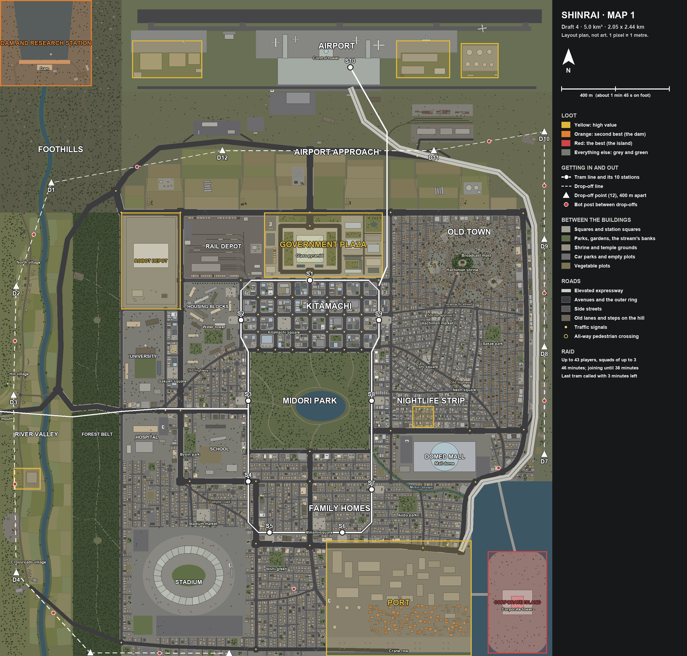

# Map 1: measured plan and district rule sheets

Draft 3, 2026-11-12 (evening). The owner cut the map from about 7.2 km² to **5 km²** "so we can pack more detail", set **43 players with backfill** and a **46-minute raid**, and asked for drop-offs far apart with bots between them. Draft 2 (earlier the same day) moved the airport 450 m further from the city and added the highways; both are kept. The plan's numbers live in one file, `data/map1/map1_plan.json` (districts, roads, rails, river, stations, drop-offs, landmarks). Every distance in this draft is checked from it by `tools/map_plan/check_map1.py`: change a number in the plan file, run the check, and copy its tables here. Section 8 explains the picture and the walkable blockout built from the same file.



**What was cut (default):** the city is untouched, so every city district, the inner loop and stations S1–S9 are exactly as in draft 2. The cut comes from the emptiest land. The west edge moved in 550 m, so the mountains become the wall of the map and the valley is a narrow river valley at their foot. The north edge moved in 310 m, so the airport is a runway, an apron and a terminal with no spare ground behind them.

This turns the approved concept picture (`docs/map_concept/city_map_concept_approved_look.webp`) into real distances, and writes down for every district what makes it different, so the map cannot fill up with copies. The picture sets *where things go*; this document sets *what they are*. Where the two disagree, this document wins.

Everything here is a proposal until the owner approves it. Labelled defaults are marked **(default)**.

## 1. Frame

- **Coordinates:** metres, north is −z, the centre of Midori Park is (0, 0), the same frame the game already uses.
- **Play area:** x −1150 to +900, z −1490 to +950: **2.05 km × 2.44 km, 5.0 km²**. The airport sits 450 m north of the city's edge, across an airport approach zone.
- **Fixed points that already exist:** Midori Park (x ±222, z ±182), the ring road around it, the north shop street and the south street.
- **Player count (owner):** up to **43 players** in squads of up to 3, with **backfill**: a player who dies early is replaced by a new one, and players can join until **38 minutes** into the **46-minute** raid (section 4b).
- **Fight rate (model estimate, from the formula in `docs/MAP_LAYOUT_PLAN.md`):** about 1.9 player fights per hour without backfill and about 2.3 with it, which is 1.5–1.8 per raid and roughly an 80 % chance of at least one. That meets the owner's 2–3 per hour at its low end. Playtests decide the final lobby size.

```text
 z      x: -1150  -880  -700         -200   0   300            900
-1490  +-------------+-----------------------------------------------+
       | [DAM*]      | AIRPORT   runway E-W along the north fence    |
       |  orange     | hangars(Y)  terminal(G)[S10]  cargo(Y) fuel(Y)|
-1150  | gorge       +-----------------------------------------------+
       | mountains   | AIRPORT APPROACH: expressway, north link      |
       | foothills D1| D12 service area (G)    D11 freight yard   D10|
 -700  +------+------+------+--------+---------------+---------------+
       |VALLEY|FOREST|ROBOT | RAIL   | GOV. PLAZA    | OLD TOWN    D9|
       | D2   | BELT |DEPOT | DEPOT  | pyramid (Y)   | shrine hill   |
 -400  |north |  ~   | (Y)  |        +---------------+ broadcast mast|
       |vill. |  ~   +------+ HOUSING| SHOP STREETS  +---------------+
       |river |  ~   |UNIV. | blocks | +-----------+ | NIGHTLIFE   D8|
    0  | D3   |  ~   |campus|        | | MIDORI    | | STRIP         |
       |hill  |  ~   +------+ HOSP./ | |  PARK     | +---------------+
       |vill. |  ~   |        SCHOOL | |  (built)  | | MALL (dome) D7|
  300  |wareh.|  ~   +-------+-------+ +-----------+ +-------------+-+
       | (Y)  |  ~   | STADIUM       | FAMILY HOMES  |  bay  [ISLAND]|
  600  | D4   |  ~   | (scav market) +---------------+  ~~~  [ RED  ]|
       |cross.|  D5  |       D6      | PORT (Y)      |  ~~~  bridges |
  950  +------+------+-----------------------------------------------+
        ~ = forest stream   [S#] = station   D# = drop-off
        (Y) yellow, (G) green, * orange
```

The valley is 270 m wide with the river down its middle; the forest belt is 180 m wide. West of x −1150 the mountains rise as backdrop: the tram and the west highway leave the map there through a tunnel mouth **(default)**.

## 2. Districts at a glance

| # | District | Area (approx.) | Loot | Threat at start → end | Role |
|---|---|---|---|---|---|
| 0 | Midori Park (built) | 0.16 km² | grey, green relays | low → moderate | The known centre; relays; first thing every new player learns |
| 1 | Shop streets (Kitamachi and the rings round the park) | 0.25 km² | green | light → moderate | Food, medicine, everyday gear; close quarters |
| 2 | Government plaza (pyramid) | 0.12 km² | yellow | moderate → heavy | Landmark; armoured offices; drone-guarded |
| 3 | Old town on the shrine hill | 0.25 km² | grey, green shrine store | light → moderate | Quiet flank, high ground, broadcast mast |
| 4 | Nightlife strip | 0.12 km² | green, yellow vault | moderate → heavy | Alleys, arcades, a pachinko vault |
| 5 | Domed mall | 0.12 km² | green | light → moderate | Big interior, car parks around it |
| 6 | Housing blocks (danchi) | 0.20 km² | grey, green locked rooms | low → light | Beginner ground; bulk loot |
| 7 | Hospital and school campus | 0.15 km² | green | light → moderate | Medical; open courtyards |
| 8 | Rail depot | 0.12 km² | grey, green containers | light → moderate | Sidings, sheds; the tram's depot |
| 9 | Robot depot | 0.08 km² | yellow | moderate → heavy | Where the repair robots come out every hour (mystery) |
| 10 | University campus | 0.10 km² | green | light → moderate | Labs, library, clock tower at the forest edge |
| 11 | Stadium | 0.20 km² | green | light → moderate | Scav market on the concourse; open car parks |
| 12 | Family homes (south) | 0.20 km² | grey | low → light | Low houses, gardens, many small interiors |
| 13 | Port | 0.25 km² | yellow | moderate → heavy | Cranes, containers, warehouses; long sightlines |
| 14 | Corporate island | 0.10 km² land | **red** | maximum, always | The best loot; two bridges only |
| 15 | Airport | 0.54 km² (was 0.90) | grey runway, green terminal, yellow hangars/cargo/fuel | moderate → heavy | Open ground, one terminal fight. 340 m deep: runway, apron, terminal |
| 16 | Dam and research station | 0.11 km² (was 0.15), plus 0.25 km² of foothills below it | **orange** | heavy → very heavy | Second-best loot, far from red |
| 17 | Forest belt | 0.30 km² (was 0.80) | grey | low → light | Quiet crossing, cover, hunting ground. 180 m wide |
| 18 | River valley and villages | 0.45 km² (was 1.20) | grey fields, green villages, one yellow warehouse | low → moderate | Countryside; drop-offs. A narrow valley, three villages along one river |
| 19 | Airport approach | 0.70 km² | grey, green service area | light → moderate | The 450 m between city and airport: the expressway, its interchange, a motorway service area, a freight yard, scrub and a low hill. Open ground with the elevated road as cover and as a sniping deck |

**Loot rule:** red only on the island; orange only at the dam; yellow never next to a drop-off. Orange and red sit at opposite corners (about 2.3 km apart, edge to edge), so a squad hunting the best loot must choose a direction.

## 2b. Streets and open ground

The overview colours each district as one block; inside, every district is streets, lanes and open space. Default proportions **(default)**: in the city about 35–45 % of the ground is streets, alleys, plazas, yards and car parks, never less than 30 %.

**Highways and main roads.** Every place connects to every other, but the network follows the land and the seams between districts instead of a grid, so it reads as grown rather than planned.
- **Airport expressway (elevated):** from the terminal south across the approach zone, then down the city's east fringe, between the old town and the map edge, past the nightlife strip and the mall, curving along the bay shore to the port. Airport freight to the port is why it exists. Inside the city it runs on pillars, so the streets underneath stay open and shaded.
- **North link:** from the expressway's interchange in the approach zone, west past the service area to a second interchange at the city's north-west corner, by the robot depot.
- **West highway:** from that interchange out through the forest, over the river on a bridge, along the foot of the mountains and off the west edge towards Utsukushii. The tram's line to the mountains runs beside it.
- **North avenue:** from the ring road straight through the shop streets to the pyramid plaza (axial, 30 m, planted median), then up to the north link.
- **Ring road** round the park (exists, 14 m), and an **east–west avenue** across the city past the park's west and east gates.
- **Coast road:** from the port west along the southern edge, through the stadium's car parks and the forest, to the crossroads village.
- **Forest road:** from the university west through the forest, over a small river bridge, to the hill village.
- **Country lanes:** link the three villages, the river warehouse and the quarry; a **mountain road** climbs in switchbacks from the north village to the dam.
- **Island bridges:** one from the port road, one from the shore by the mall.

**Real two-way traffic layout (owner's rule: it has to be real).** Japan drives on the left, so every road is laid out for left-hand traffic:
- **Expressway and west highway:** dual carriageway, two lanes each way, a central barrier, hard shoulders, slip roads at the interchanges, emergency phones and exit signs.
- **Avenues and the ring road:** two lanes each way with a planted median, turn lanes and signals at junctions, pedestrian crossings.
- **Ordinary city streets:** one lane each way with a centre line, kerbs and pavements; bus stops on a few.
- **One-way streets only where Japanese cities really have them:** narrow shopping lanes and alley streets, with the matching signs.
- **Country roads:** one lane each way; the narrowest lanes are single track with passing places, as on real rural roads.
- Abandoned cars face the right way for their lane.

What this gives play: the elevated expressway is a fast, exposed route and a long sightline; the ground under it is cover. The west highway is the obvious way in from the valley, the forest road and lanes the quiet ones.

**Inside districts (from the rule sheets):**
- Shop streets: 6–9 m shopping lanes, covered arcades, 1.5–3 m service alleys behind the shops.
- Nightlife strip: one main street and 2–4 m alleys every 15–30 m, many with stairs and dead ends.
- Old town: winding lanes 3–5 m wide, stone steps, garden walls, no straight run over 60 m.
- Family homes: 4–6 m residential lanes, footpaths between gardens, a few vacant lots.
- Housing blocks: courts, car parks, footpaths and play areas between the slabs.
- Port: wide wharves and container aisles; airport: apron and taxiways. These are the open, exposed ground.

**Open space on purpose:** the pyramid plaza, stadium car parks, mall car parks, school sports ground, university quad, the port's container yards, the airport apron, parks small and large, rice fields. Fights need both close quarters and open ground to cross.

Each district gets its own street-level plan, drawn and shown before it is built.

## 2c. Living streets, true to real Japan

The city is evacuated but still maintained by machines, so it moves and hums without people. Everything that moves or makes sound copies how it works in real Japanese cities (owner's rule: realistic to the real world). Before any element is built, collect reference photos of the real thing and match it side by side.

- **Measurements from Japanese standards:** lanes about 3.0–3.25 m, kerbs about 15 cm, pavements 2–4 m, utility poles every 30–40 m with transformers and dense overhead lines, guard rails at junctions.
- **Signs and markings to Japanese conventions:** blue direction signs, the red inverted-triangle stop sign 止まれ with its road marking, white zebra crossings, the green-and-white pedestrian signals.
- **Signals that behave like real ones:** realistic cycle times with an all-red phase, flashing pedestrian green, and crossing sounds in the real style (bird-chirp tones). Sounds are our own recordings or licensed effects, never copied melodies.
- **Shops:** noren curtains, sample displays, vending machines in clusters as real streets have them, shutters on closed shops, the shop's type deciding its dressing.
- **Wildlife that lives in Tokyo:** jungle crows, pigeons, stray cats, cicadas in summer; deer and wild boar only at the forest edge.
- **Light in 2050:** LED street lighting, neon and backlit signs, some windows lit on timers.
- **Seasons and weather follow Japan:** cherry blossom in spring, cicadas and humidity in summer, red maples in autumn; rain and puddles.
- **Reflections:** shop windows and glass towers reflect the street (reflection probes per block, screen-space reflections on High); wet asphalt and puddles after rain mirror signs and lamps; polished stone and metal shutters catch light. Kept within the memory budget: probes update rarely, not every frame.
- **Smoke and steam:** kitchen exhaust from ramen and yakitori shops, steam from manholes and vents on cold mornings, rooftop air-conditioning units with heat shimmer in summer, a slow plume from the bathhouse chimney, and occasional smoke from scav camps. Soft particles that fade with distance, drifting with the shared wind.
- **Check:** each finished street is compared with real reference photos from the same kind of place before it is accepted.

## 2d. One town, not sections (owner, 2026-11-13)

**Owner's rule:** "we need it to have places like town squares, smaller parks in between; places in real life are not isolated in sections like this." The districts in section 2 are names for areas, not walled boxes.

**Second rule (owner, 2026-11-13):** nobody should be able to tell the layout was machine-made: no repetition, no sloppiness, and nothing bent or placed without a reason. Draft 4 is built on that. Every shape in the city has a cause, the way a real town's does:

- **A history.** The oldest thing is the **old highway**, from the mountains to the bay. Its stretch along the north of the park is the shopping street that is already built; west of the park it survives as a diagonal street through the housing estate; east of the park it runs down to the old shore, and the bar district grew along it. The **shrine approach** climbs from a torii on the highway to the shrine on its hill. **Temple road** is an old lane to a temple that is still there.
- **The built grid stays.** Kitamachi, north of the park, is the 64 m grid with 14 m streets that already exists in the game. The plan matches it line for line, and the tram loop was moved a few metres to run on the next line of that grid (station S1 is now at z −448; S2 and S9 at x ±256).
- **Tracts, not one grid.** The roads cut the city into about 75 tracts. Each tract lays its own streets square to the most important road beside it, so neighbouring tracts sit at different angles and meet at seams, exactly where the older road runs. Inside a tract the streets are straight and regular, as real ones are; the variety is between tracts.
- **Real proportions.** House streets are 4–5 m wide; blocks are long and thin, two plots deep; cross streets do not line up from one row to the next; some streets stop short as dead ends.
- **Buildings face their street.** Every building stands on a plot along a street and follows its line, curves included. What it is depends on the street: tall along avenues and the ring, shop-houses along the old highway and the shrine approach, houses on back streets, narrow bar buildings in the alleys.
- **Kitamachi's equal blocks each hold something different:** a block ringed with buildings, one cut by a passage of small shops, one taken by a department store, a school in its yard, a multi-storey car park, half a block of park.
- **The shrine hill has no grid.** Lanes follow the slope in broken rings, steps climb it, the shrine sits in a grove at the top with the broadcast mast behind it, and four temples with their graveyards stand at its foot along Teramachi street.
- **Leftover land becomes what it does in a real town:** car parks, empty plots somebody parks on, vegetable plots, gardens and clumps of trees, tiny shrines, and a children's park in most neighbourhoods. The plan has about 140 car parks, 115 empty plots, 120 gardens, 25 vegetable plots and 13 small shrines.
- **Named places sit where roads meet** (plan file, default positions): Kitamachi square (one whole block of the grid), Torii square, Neon square (the five-way meeting of the old highway, Sakae street and Hanamachi street), Hachiman market, Minami square, Gakuen square, Stadium market, Aoba park, Sakae park, Byoin park, Nishi green. Every tram station has its own small square.
- **A stream.** The park lake drains to the bay as **Midori stream**, through the family homes between green banks with a footpath.
- **One ground.** The lived-in city shares one floor; a neighbourhood is told by its buildings and streets, not by a coloured patch.

The earlier experiment of bending the whole city with noise is gone: it curved streets for no reason, which is exactly what gives a generated map away.

Still plain in this draft, on purpose or for now: the robot depot and the rail depot are large single-use sites (a fenced compound and a railway yard are like that); the government plaza is a formal square; the countryside and the airport have not had this treatment yet; junctions are not designed; the hill is drawn but the blockout's ground is still flat.

The district areas in section 2's table are from draft 2 and no longer match; the plan file has the real corners.

## 2e. Roads that could carry the traffic (owner, 2026-11-13)

The owner asked whether the first layout would cause traffic jams. It would have: everything had to go round the 14 m ring road at the park, no road carried through from one side of the city to the other, the expressway had no way on or off inside the city, and the stadium, the mall and the port each hung off one street. The city is empty in 2050, but the roads have to be ones a real city could have lived with.

- **The inner ring stays local.** The ring road at the park is already built at 14 m and carries the tram. It is no longer asked to carry through traffic.
- **A new outer ring** takes that traffic round the centre: along the north edge of the city (22 m), down the east side under the elevated expressway (18 m), along the port (20 m), and up the west side between the housing and the university (20 m).
- **Through avenues** cross to the ring and beyond: the north avenue to the north link, the new south avenue from the park to the port, the west avenue on to the west highway, the east avenue to the expressway.
- **The expressway has ramps** at the airport, the north link, the old town, the east avenue and the port, so airport-to-port lorries never touch a city street.
- **Collector streets:** about every fifth street in the woven neighbourhoods is wider (11 m) and gathers the side streets onto the avenues.
- **The stadium** empties onto the outer ring, the coast road (now 14 m) and station S5.

Not done: junction design (signals, turn lanes), one-way pairs in the shopping lanes, and car parking counts. The widths are defaults.

## 2f. Real ground (2026-11-13)

The blockout's ground is no longer flat. Heights come from `tools/map_plan/terrain.py`, are saved one every 2.5 m, and are metres above the bay. Each rise has a cause the plan already implied:

| Ground | Height | Why it is there |
|---|---|---|
| City plain | 3 m | Flat coastal land. Kitamachi and the park are built flat. |
| Shrine hill | +28 m | The one hill in town, so the shrine and the mast stand on it. |
| Forest ridge | +20 m, saddle at z 30 | Why the city stops there. The west avenue, the tram and the highway all use the one saddle. |
| Valley floor | 2 m above the river, which falls 11 m from the dam to the coast | The river made it. |
| West slope | up to +30 m at the map edge | The valley lane runs along its foot, so the slope bends where the lane bends. The tunnel is in a side valley. |
| Dam hills and gorge | +66 m; crest 78 m, reservoir 73 m | The river comes down a gorge; the dam joins its two sides. |
| Water | bay 0, river 2 m down, lake 1.2 m, stream 1.6 m | Water lies below its banks. Where a road crosses, the ground stays up. |

New roads from this: the mountain road now climbs the west side of the gorge in hairpins, a works road climbs the east side to the research station, and the dam crest road joins them: 190 m with no cover, the only way across the gorge. Nothing is built where the ground falls more than 7 m across one footprint.

Countryside, laid out from causes in `tools/map_plan/country.py` (no scatter):

- **Valley:** paddies cut into strips by farm tracks from the lane or the highway to the river; rice terraces on the slope behind two villages; houses along the lane; a mill and footbridge, a hill shrine up steps, a petrol station and co-op at the crossroads; the warehouse between lane and river with a jetty; the quarry cut into the slope.
- **Forest:** a crest trail, three crossing trails, a lookout clearing at the top, a forestry yard, an old clearing.
- **Foothills:** rock only where the ground is too steep to hold soil.
- **Approach:** market gardens between the outer ring and the highway on farm lanes with one kink each; a substation with pylons, a cemetery, glasshouses, a water works; the highway service area; a rail-served freight yard; airport parking and a hotel.
- **East strip:** yards, sheds and plots along a service lane behind the expressway.
- **Airport:** runway, taxiway and five links; three aprons (passengers, freight, maintenance) with grass between; a terminal with two piers of different length and the tower over it; hangars, freight sheds, a bunded fuel farm, a fire station; aircraft at their stands and one left on the taxiway.
- **Government plaza:** still formal inside the ring, but the east side is now a working quarter (ministry round a court, hotel, courthouse, archive, police, car park, a garden with a pond) and the west side has the post office, a row of lunch places, the press building and bus bays.
- **Tram depot:** one lead off the loop fans into car barn, workshop, stabling, wash and test roads; trams stand where they were left. Its edges belong to the town: a railwaymen's terrace and bathhouse to the north, lock-up shops along the tram street.
- **Robot depot:** left as one sealed compound on purpose. It is where the robot patrols start (section 4c).

## 2g. Junctions (2026-11-13)

`tools/map_plan/junctions.py` finds every meeting of the plan's roads (110) and gives each a rule. Japan drives on the left, so the right turn is the one that needs its own lane.

| Meeting | How it is run | Count |
|---|---|---|
| Two main roads, or a main road and a town street | Signals. Right-turn lane on a main road 18 m or wider (20 m when it meets a town street). | 76 signalled, 29 of them with right-turn lanes |
| Two town streets, both 12 m or wider | Signals | counted above |
| A narrower street, an old lane or a country road joining | Stop line on the smaller road | 30 |
| Two country roads | Give way | 2 |
| The busiest crossing beside S1 and S9 | All-way pedestrian crossing | 2 |

Every corner is cut back (2.5, 4 or 6 m by road width). The blockout has signal posts at the signalled corners. Side streets inside the tracts are not listed: they meet at plain give-way corners.

## 3. Rails and stations

- **Inner loop (extraction):** a rounded rectangle on the ring road around the park and its first ring of streets: x ±225.5 widened to the shop streets, z −430 to +490. Length about 2.7 km.
- **Ten stations** (default positions):

| Station | Position (x, z) | Serves |
|---|---|---|
| S1 | (0, −448) | Kitamachi, government plaza |
| S2 | (−256, −300) | Rail depot, housing |
| S3 | (−229, 0) | Housing, university |
| S4 | (−229, 300) | Hospital and school |
| S5 | (−150, 490) | Stadium, family homes |
| S6 | (120, 490) | Family homes, port |
| S7 | (229, 330) | Mall, port |
| S8 | (229, 0) | Nightlife strip |
| S9 | (256, −300) | Old town |
| S10 | (150, −1240) | Airport terminal (branch line from the loop's north-east corner, about 1 km, beside the expressway) |

Gaps between neighbouring loop stations: 190–330 m, so from anywhere in the city a station is two to four minutes on foot. The countryside has **no station** **(default)**: leaving from the valley means walking into the city, which is the price of a quiet drop. The dam and the island also have none.

- **Outer drop-off line:** runs up the valley at the foot of the mountains, across the airport approach beside the north link, and down the east side, and stops short of the bay. It no longer loops round the airport.

## 4. Drop-off points (12)

Checked by `tools/map_plan/check_map1.py` against every yellow, orange and red zone (yellow must be more than 250 m away, orange and red more than 350 m), against each other, and against the nearest station.

**Owner's rule (2026-11-12): drop-offs are far apart.** Default number: every drop is at least 400 m from the next one.

The high-value zones the check uses **(default positions, x then z)**: government plaza −170..270, −700..−430; robot depot −700..−480, −700..−340; pachinko vault 380..460, 20..100; port 60..600, 520..950; hangars −660..−400, −1340..−1200; cargo sheds 320..520, −1340..−1200; fuel farm 560..700, −1330..−1200; river warehouse −1100..−1020, 250..330; dam (orange) −1150..−810, −1490..−1170; island (red) 660..880, 560..940.

| Drop | Position (x, z) | Area | Nearest high-value zone | Nearest other drop | Nearest station (walk) |
|---|---|---|---|---|---|
| D1 | (−960, −810) | Foothills, below the dam road | Dam (orange), 360 m | 406 m | S2, ~5 min |
| D2 | (−1090, −425) | Valley, north village | Robot depot, 390 m | 405 m | S2, ~5 min |
| D3 | (−1100, −20) | Valley, hill village | River warehouse, 270 m | 405 m | S3, ~5 min |
| D4 | (−1090, 640) | Valley, crossroads village | River warehouse, 310 m | 405 m | S4, ~5 min |
| D5 | (−815, 938) | South-west forest edge | River warehouse, 636 m | 405 m | S5, ~5 min |
| D6 | (−300, 940) | Stadium car parks, east end | Port, 360 m | 515 m | S5, ~3 min |
| D7 | (870, 200) | East edge, by the mall | Island (red), 360 m | 400 m | S7, ~4 min |
| D8 | (870, −200) | East edge, nightlife side | Pachinko vault, 465 m | 400 m | S9, ~4 min |
| D9 | (870, −600) | East edge, old town | Government plaza, 600 m | 400 m | S9, ~4 min |
| D10 | (870, −1000) | Approach, expressway east end | Fuel farm, 262 m | 400 m | S10, ~4 min |
| D11 | (460, −930) | Approach, freight yard | Cargo sheds, 270 m | 416 m | S10, ~2 min |
| D12 | (−325, −930) | Approach, service area | Government plaza, 277 m | 646 m | S10, ~3 min |

All twelve pass. Walks assume 3.85 m/s and 30 % detour.

What the smaller map costs here, said plainly:
- **The margins are thinner.** Three drops (D10, D11, D12) are only 262–277 m from a yellow zone, against a 250 m rule. On the bigger map the tightest was 311 m.
- **The airport has no drop-off of its own (default).** At 340 m deep, no point on its fence is far enough from the hangars, cargo sheds and fuel farm. Players reach it from the approach drops or station S10.
- **Walks are shorter:** no drop is more than about 5 minutes from a station (it was 8).

**Solo, duo and trio (owner's rule: spawns differ by group size):**
- **Trios** use the valley and foothill drops (D1–D5): the longest walks, the most ground to cover, the most loot on the way.
- **Duos** use the stadium, east-edge and approach drops (D6–D12).
- **Solos** (default) get their own extra stops on the inner loop's quieter side (S2, S3, S5, S6) a minute or two after the others have spread out, so a solo never lands next to a full squad.

**Drawn together without starting together (owner's rule):** every drop is far from high-value loot, but every route from a drop to a station runs through the city's green districts, and the stations sit on the one loop. Squads spread out at the start and converge on the same ring of streets as the raid goes on. Threat rising over time pushes them inward too.

### 4a. Bots between the drop-offs

**Owner's rule (2026-11-12):** between neighbouring players there are bots, so that when anyone shoots, the players either side can hear it. A squad cannot land and stay silent: the first fight near a drop tells its neighbours where it is.

- **One bot post about midway between each pair of neighbouring drops.** With drops 400–785 m apart, a post is 200–395 m from the drops on either side.
- **Hearing range (default): gunfire carries 450 m to a player.** The game has no set figure for this yet; it needs a sound test in the park before the posts are placed for real.
- **What a post is (default):** a small group of the zone's staple enemy, placed on the natural route inward from both drops, so most squads meet it within their first few minutes.

| Between | Gap | Post (x, z) | Note |
|---|---|---|---|
| D1–D2 | 406 m | (−1025, −618) | Foothill road |
| D2–D3 | 405 m | (−1095, −222) | Between the north and hill villages |
| D3–D4 | 660 m | (−1095, 310) | Falls on the river warehouse: its guards are the post |
| D4–D5 | 405 m | (−952, 789) | Coast road |
| D5–D6 | 405 m | (−612, 939) | Forest edge by the stadium |
| D6–D7 | 1,479 m | two posts | The port and the bay lie between. One post in the family homes, one by the mall |
| D7–D8 | 400 m | (870, 0) | Under the expressway |
| D8–D9 | 400 m | (870, −400) | Old town's east lanes |
| D9–D10 | 400 m | (870, −800) | Expressway interchange |
| D10–D11 | 416 m | (665, −965) | Freight yard |
| D11–D12 | 785 m | (68, −930) | North avenue under the north link |
| D12–D1 | 646 m | (−642, −870) | North-west interchange, by the robot depot |

### 4b. Backfill and late joining

**Owner's rules (2026-11-12):** the raid holds up to 43 players. A player who dies early is replaced. Players can join until 38 minutes into the 46-minute raid.

Defaults for the parts not yet decided:
- **A new arrival comes in by the deployment train**, at a drop-off with no living player within 400 m.
- **A whole squad that has died or left is replaced by a squad of the same size or smaller.** A stranger is never added to a living squad.
- **A late joiner needs a way out.** Someone who joins at 38 minutes has 8 minutes left, and the last tram is called with 3 minutes left. So after 30 minutes new arrivals use only the drops within about 4 minutes of a station (D6–D12) or the inner-loop stops.
- **Still open:** whether loot restocks for late arrivals, and whether a late joiner is told how much time is left before they commit.

### 4c. What you meet between fights (owner's ideas, 2026-11-13; all numbers are defaults)

Fights between players are rare by design: about 2 an hour (section 4). So the minute-to-minute game is looting, robots and scavs. The plan file's `encounters` key holds the hand-placed parts; `tools/map_plan/encounters.py` picks the rest from the generated town by rule. The picture is `docs/map_concept/map1_encounters_draft4.png`.

| Scav cove | Where | Crew | Why there | Patrol |
|---|---|---|---|---|
| Ridge lookout | top of the forest ridge | 8 | Sees the valley and the city, hidden by trees | the crest trail, 550 m |
| Stadium camp | the stadium | 10 | A bowl with a wall round it and few ways in | round the concourse |
| Mast camp | the shrine hill | 8 | The only high ground in the east, with the mast for a radio | the lanes halfway up the hill |
| Estate towers | a tower of the housing blocks | 8 | One stair, long views over the estate's greens | from green to green |

Rules: a cove's edge is at least 250 m from a drop-off and 150 m from a tram station (checked by `check_map1.py`; drop-off D6 moved 110 m east and the Mast camp moved to make this true).

| Also on the map | Pool | Used in one raid | Picked how |
|---|---|---|---|
| House a scav lives in | 42 | 12 | Off the main roads robots patrol, near water or something that grows, 220 m from a drop-off |
| Robot lying dormant in a building | 34 | 10 | Car parks, big sheds, hangars, power and water plant |
| Robot work site that closes a street | 29 | 6 | The middle of a side street, so the way through a block changes |
| Robot patrol route | 5 | 2 groups on each | Park ring, outer ring, depot round, east round, port run |
| Robot recharge station | 21 (72 bays, 49 robots) | about 13 live | Where a city would put them: tram stop squares, under the expressway, public car parks, site gates, free plots on wide main streets; never on a road, a house street, by a school, or within 150 m of a drop-off; 150 m apart |
| Roaming scav crew | | 4 | Looting from one open building to the next |
| Bird spots | 40 | all | Crows on roofs round every cove and named square, pigeons on squares, herons at the water |

Measured by playing 200 raids on paper (`reports/map1/encounter_measure.txt`):

- The city is 2.5 km², half the map. Roofs cover 19% of it and 29% of the lived-in streets.
- From any point on a town street, something alive is typically 100 m away (about 35 seconds on foot). Nine points in ten have one within 190 m. Half have one within 100 m.
- **Owner's rule (2026-11-13): only 15% of buildings stay shut.** 3,518 of 4,138 town buildings open (85%); 620 stay shut. Buildings of 5, 6 and 7 floors were made rarer (142, 101 and 69, from about 220 each). Where one is not built the plot gets something with character, in seventeen kinds taken in turn (361 plots): pocket parks, squares, playgrounds, gardens, coin car parks, empty lots, café terraces, market stalls, street shrines, bicycle parks, vending corners, billboard towers, public toilets, police boxes, one-floor corner shops and workshops, and a few robot recharge stations (the 23 stations and where they may stand: `docs/GAME_DESIGN.md` 8). Six planned dead ends among the homes end in a turning circle with five houses round it. A square, park or shrine ground is now 57 m from any street point on average (it was 88 m), and roofs cover 26% of the lived-in streets (it was 29%). Every building of five floors or more is an office (100), ordinary apartments (220) or luxury apartments (26), set by where it stands. Half of them are shut (180 of 359), and the rest of the share is spread over the low ones (440, so 88% of low buildings open). Steps are uneven so shut buildings never come in a rhythm; a scav home or robot building is never one of them. The nearest open door is 14 m away on average. The shut ones are placeholders; each kind of shut building has two looks, taken in turn along a street. About 3,000 of the open ones have an upstairs. 415 have a locked door with better loot behind it (one in 12 in grey districts, one in 5 in green, one in 3 in yellow), 30 m from any street point on average. The rules for doors and windows are in `docs/GAME_DESIGN.md` 7b. This is the big cost: see section 7.
- A square, park or shrine ground is 88 m away on average, 148 m for nine points in ten.

Birds, crows eating a looted body, and the body turning to bones are game code, not map plan: `scripts/wildlife/` and `docs/GAME_DESIGN.md` 7a.

### 4d. Ready-to-build audit (2026-11-13)

`python tools/map_plan/audit_map1.py` reads the plan and the generated map and checks the spacing and size of things for play. It changes nothing. All 48 checks pass. What the first run found, and the fix:

| Found | Fix |
|---|---|
| Recharge stations 37 to 84 m from drop-offs D7, D8 and D12 | A station is never within 150 m of a drop-off: the two under the expressway moved between the east drop-offs, the one at the service area was removed |
| Drop-off D10 had nothing to search for 330 m | An east farm by the highway: two houses, a barn, a shed round a yard, 47 m from the drop |
| Fourteen roads with a dead-straight view of 450 m to 1,600 m | 36 groups of vehicles stalled across the lanes in the evacuation (a bus, a lorry, a van, each group arranged differently). The longest clear view down any carriageway is now 393 m. No street was moved. Pavements still give a long view past them. |
| Nothing checked what a quiet player notices | An event schedule (`events` in the plan file; `docs/GAME_DESIGN.md` 8): about 12 things noticed in a raid, 9 minutes at most between two, typically |

What the audit holds true from now on:

- every drop-off has a door to search within 260 m and no cove, station, dormant robot or lived-in house within 150 m; no robot patrol group starts a raid within 250 m of one;
- a recharge station is at least 18 m from a tram platform (the nearest is 32 m; it wakes at 6 m);
- no clear straight view over 450 m; scav coves at least 250 m apart (a crew goes on guard at gunfire within 220 m);
- no building further than 260 m from something that can be alive (the worst is 197 m), and in any one raid 15 to 45% of the town has nothing alive within 150 m (it is 17%): calm stretches, not emptiness;
- town buildings between 14 and 3,200 m² (median 60 m²), under 2% of them too narrow for a room and a stair.

## 5. District rule sheets

Each sheet sets the four things that make a district its own (street pattern, height, age, purpose), its building kit, its one-of-a-kind landmarks, and what must not happen there. A kit is about ten building types used only in that district; neighbouring districts blend over 50–150 m at their edges instead of switching at a line.

### 0. Midori Park (built)
- **Pattern:** curving paths, lake, groves. **Height:** none; trees only. **Age:** 1990s park, 2050 refits (relays, lamps).
- **Kit:** already built; keep.
- **Landmarks:** the lake and its islands, the torii plaza.
- **Never:** new buildings inside the fence.

### 1. Shop streets
- **Pattern:** tight shotengai grid, covered arcades, 6–9 m lanes. **Height:** 2–5 floors. **Age:** 1960s–1990s shop-houses with 2050 signage.
- **Kit:** konbini, pharmacy, ramen and izakaya, barber, greengrocer, capsule hotel, police box, pachinko-free arcade, small office over shops, covered arcade roof.
- **Landmarks:** one covered arcade with a glass roof.
- **Never:** two identical shop fronts side by side; every lot differs in width (4–9 m) and storey count.

### 2. Government plaza
- **Pattern:** axial: one wide avenue into a paved plaza. **Height:** 8–20 floors round the plaza; the pyramid in the middle. **Age:** 2040s.
- **Kit:** ministry slab, records annex, security checkpoint, plaza kiosks, underground car-park ramps.
- **Landmarks:** the glass pyramid (one only), visible from the whole map.
- **Never:** greenery in rows; planting is in irregular sunken gardens.

### 3. Old town on the shrine hill
- **Pattern:** organic lanes following contours, steps, dead ends. **Height:** 1–2 floors, timber. **Age:** pre-war to 1970s.
- **Kit:** machiya townhouse (three widths), storehouse (kura), small temple, tea house, tiled-wall lane, stone steps with lanterns, garden plot.
- **Landmarks:** the shrine at the top, the broadcast mast beside it.
- **Never:** straight streets longer than 60 m.

### 4. Nightlife strip
- **Pattern:** one main street, many 2–4 m alleys off it. **Height:** 3–7 floors, narrow and tall. **Age:** 1980s–2010s, layered signs.
- **Kit:** "pencil" bar building, karaoke, game centre, pachinko hall with vault, love hotel, snack bars in one building, stair-and-sign facade.
- **Landmarks:** one vertical neon tower sign (one only).
- **Never:** signs on every building at the same height.

### 5. Domed mall
- **Pattern:** one big block with car parks on three sides. **Height:** 4 floors plus a glass dome. **Age:** 2030s.
- **Kit:** the mall (one building, many interiors), multi-storey car park, bus loop, delivery yard.
- **Landmarks:** the glass dome.
- **Never:** a second dome anywhere on the map.

### 6. Housing blocks (danchi)
- **Pattern:** slab blocks at varied angles round shared courts, not in rows. **Height:** 5–11 floors. **Age:** three building eras: 1970s slabs, 1990s point towers, one 2040s infill block.
- **Kit:** slab (two lengths), point tower, low shop row, kindergarten, water tower, bicycle shed, playground, car park, community hall.
- **Landmarks:** the water tower.
- **Never:** more than two slabs at the same angle next to each other.

### 7. Hospital and school campus
- **Pattern:** campus: buildings round courtyards and a sports ground. **Height:** 3–9 floors. **Age:** 1990s school, 2030s hospital wing.
- **Kit:** ward block, outpatients, ambulance bay, helipad roof, school block, gym, pool, sports ground.
- **Landmarks:** the helipad on the hospital roof.

### 8. Rail depot
- **Pattern:** long parallel tracks (allowed here: railways are straight). **Height:** single-storey sheds, one tall signal box. **Age:** 1980s, 2040s rolling stock.
- **Kit:** carriage shed, maintenance pit, signal box, sidings with parked trams, staff block, fuel point.
- **Landmarks:** the signal box.

### 9. Robot depot
- **Pattern:** fenced compound, one big hall, open yard. **Height:** one tall hall. **Age:** 2045, clean and unexplained.
- **Kit:** the hall with large doors, charging racks, parts store, control room, robot bays.
- **Landmarks:** the hall doors, which open on the hour **(default: as a set piece later)**.
- **Never:** explain it. Show only.

### 10. University campus
- **Pattern:** quad and paths at the forest edge. **Height:** 3–6 floors. **Age:** 1960s main hall, 2030s labs.
- **Kit:** main hall with clock tower, labs, library, dormitory, canteen.
- **Landmarks:** the clock tower.

### 11. Stadium
- **Pattern:** one oval with radiating car parks and plazas. **Height:** stadium bowl. **Age:** 2020s.
- **Kit:** the stadium, concourse stalls (scav market), ticket gates, car parks, a practice pitch.
- **Landmarks:** the stadium roof.

### 12. Family homes
- **Pattern:** irregular small lots on narrow lanes, gardens, a few vacant lots. **Height:** 1–3 floors. **Age:** mixed, 1960s to 2040s, every house different.
- **Kit:** at least eight house types plus small apartment buildings, a corner shop, a shrine, a laundry, a small park.
- **Never:** the same roof twice in a row.

### 13. Port
- **Pattern:** wharves, container stacks, warehouse rows along the quay. **Height:** low warehouses, very tall cranes. **Age:** 2010s–2040s.
- **Kit:** container stack (varied heights and colours), warehouse (three sizes), crane, reach stacker, office block, customs shed, fuel tanks.
- **Landmarks:** the crane row (cranes differ in model and height).

### 14. Corporate island
- **Pattern:** one tower with a podium and gardens. **Height:** one supertall tower. **Age:** 2048.
- **Kit:** the tower (many floors, few enterable), podium, guard posts, the two bridges.
- **Landmarks:** the tower, visible everywhere.
- **Always maximum threat.** Its own staple enemy (end-game work).

### 15. Airport
- **Pattern:** runway east-west, apron, terminal on the city side. **Height:** low terminal, control tower, hangars. **Age:** 2030s terminal, older hangars.
- **Kit:** terminal (one building), control tower, hangars (three sizes), cargo sheds, fuel tank farm, parked aircraft (few, different types), service vehicles.
- **Landmarks:** the control tower.
- **Never:** aircraft lined up identically.

### 16. Dam and research station
- **Pattern:** a concrete dam in a gorge, the station built into its face. **Age:** 1970s dam, 2040s research levels.
- **Kit:** dam crest road, spillway, research levels, turbine hall, access tunnel.
- **Landmarks:** the dam.

### 17. Forest belt
- **Pattern:** natural forest with clearings, two trails and one service road. **Never:** trees on a grid; follow the park's natural-grove rules.

### 18. River valley and villages
- **Pattern:** the river winds; three villages each with a reason to differ **(default)**:
  - **North village:** a mill and bridge on the river, timber houses along one lane.
  - **Hill village:** terraced houses and a shrine on a slope above rice terraces.
  - **Crossroads village:** a petrol station, a farm co-op and a bus shelter where two lanes meet.
- **Other features:** rice terraces (curves follow the slope, never repeated), a quarry, scattered farm sheds, one riverside warehouse (yellow).

## 5b. Reuse the buildings already made

The park's surroundings already hold many finished, approved buildings. They are the starting kits for the new districts, not one-offs to leave behind.

**Owner's rule (2026-11-13):** this reuse is for buildings that open. The 15% that stay shut are new models made for the purpose, two looks for each building kind, never an old building with its door closed. Every open building needs an inside stair to every upper floor, so each reused building below must be checked for one (`docs/GAME_DESIGN.md` 7b).

| Existing building (script or scene) | Reuse in |
|---|---|
| Konbini, drugstore, ramen, gyoza, barber, greengrocer (yaoya), bookshop, flower shop, bike shop, estate agent (fudosan), handmade shop, coin laundry, police box (koban), capsule hotel, business hotel, mixed-tenant building (zakkyo) — `scripts/midori_near_city_*.gd` | Shop streets (district 1) |
| Pachinko hall, karaoke, snack-bar building, pencil building, game centre, big screen, yakitori shop (`assets/shinrai/buildings/yakitori_shop`) | Nightlife strip (4) |
| Wagashi shop, coffee shop (kissa), bathhouse (sento), handmade shop | Old town (3), in older timber and tile finishes |
| South street homes and shop flats, neighbourhood houses (`midori_south_street_*`, `midori_neighbourhood_context.gd`) | Family homes (12) |
| Fukumaru apartments | Housing blocks (6) |
| Corporate district, its garage, police station, stairs and lifts (`assets/shinrai/districts/corporate_command`) | Government plaza (2), and the police station for the old town or hospital edge |
| Viaduct pieces (`midori_near_city_viaduct.gd`) | Rail depot (8), the expressway's pillars |
| Clubhouse and cafeteria, café, ceramics gallery | University campus (10) and the stadium |

**How reuse stays unrepetitive:**
- Most near-city buildings are built by code, so each placement varies its width, floor count, signage, colours, materials and dressing; a copy is never placed next to the same variant.
- Landmark buildings (police box, bathhouse, pachinko hall, police station) appear once per district at most.
- The same shop type looks different by district: a wagashi shop is tile and concrete on the shop streets, timber in the old town.
- Interiors that already exist stay enterable.

## 5c. Shop streets: build status and next layers

**Done (2026-11-12, uncommitted):** `scripts/midori_shop_streets.gd` makes the existing city block north of the park walkable (floors, solid shells, boxes, hand-built shops, posts and expressway piers; checked by `tests/shop_streets_check.gd`). `scripts/midori_street_dressing.gd` adds vending clusters and bike racks, kitchen exhaust, the bathhouse plume and seven reflection probes. `Play Shop Streets.cmd` starts raids on the north avenue.

**Seen in the first close-ups and fixed in code (not yet re-tested):** the vending machines faced the wall (turned round); they stood in the middle of the pavement (now backed against the building line); the manhole steam read as a glowing ball (switched off until a proper smoke texture is approved).

**Next layers, in order:**
1. **Ground floors.** The generated buildings have blank ground floors, which is what makes these streets look empty. Record each shell's street front in the near city (as for the footprints), then give every ground floor a shop front by lot type: shutters down on most, a few lit and open, noren, sample displays, menu boards, signs at varied heights. No two neighbours alike.
2. **Clutter by shop type.** Stools and crates, bicycles at house doors, umbrella stands, potted plants, delivery boxes, A-frame signs, waste bins with the city's sorting labels, a few traces of a hurried leaving.
3. **Working street systems.** Signal cycles with an all-red phase and flashing pedestrian green, crossing chimes, vending machine hum and glow, buzzing signs, automatic doors that open as you pass.
4. **Steam and smoke done properly.** Needs a real smoke texture or flipbook (to be shown for approval first); then manhole steam on cold mornings, kitchen exhaust visible from the street, rooftop AC heat shimmer in summer.
5. **Night.** Lit windows on timers, neon, light spilling onto the pavement; check every layer at night.
6. **Sound.** Air-conditioning hum, sign buzz, distant trains, crows, cicadas in summer; emitters on the objects themselves.
7. **AI in the streets.** Extend the drones' and scavs' walk grid into the district so they can follow the player there.

**Enterable buildings and parkour (owner, 2026-11-12: "buildings need to be enterable, we will need to add some sort of parkour in it too").**
- **Which buildings open (default):** every hand-built shop, plus about one generated building in four in the shop streets; more in later districts where loot lives. The rest stay shut, but read as real: shutters, locked glass doors, curtains.
- **Generated interiors from a kit, not by hand:** a stairwell core, corridors, and rooms sized to the lot (shop floor, back room, flats above, a roof door). Each shop type furnishes its ground floor; upper floors are flats, offices or storage, varied per building. Unique interiors stay for landmarks.
- **Real ways in:** front doors, shutters that can be forced, back doors from the service alleys, windows (the existing `scripts/building_access` doors and casements), and the external steel fire-escape stairs common on Japanese mid-rises.
- **Parkour that suits a real city:** the player already vaults and mantles up to 1.7 m (`MANTLE_MAX_HEIGHT`). Add: climbing ladders and fire escapes, getting onto low roofs from walls, crates and AC units, crossing between close roofs over short gaps, balconies, drop-downs with fall damage, and squeezing through alleys. Rooftops get water tanks, AC units, fences and stair huts as cover and routes. Nothing superhuman.
- **Play:** roofs and upper floors give height and sightlines; interiors give close-quarters fights and loot; routes through buildings let a player cross a street without stepping into it.
- **Cost to watch:** interiors load only when the player is near (memory); AI must be able to follow inside, which needs the walk grid extended into buildings.

Each layer is shown with same-camera pictures (`tests/district_capture.gd`, `tests/dressing_capture.gd`) before the next starts.

## 6. Build order

1. **Shop streets north of the park** (district 1, part). They touch the park and reuse what exists.
2. **Housing blocks west** and **old town north-east**.
3. **Nightlife strip and mall** (east), with the inner loop extended to its full size.
4. **Stadium, family homes, port** (south).
5. **Forest belt** and **river valley** (west), with the drop-off line.
6. **Airport, dam, island**.

Each step must load only when the player is near it, so memory stays under the 8 GB target. Each step is shown to the owner with same-camera pictures before the next starts.

## 7. Open decisions (owner)

- Countryside station, or walk in **(default: walk in)**.
- Solo drops on the inner loop **(default above)** or their own edge points.
- Where the cut was taken: this draft trims the valley, forest, mountains and airport and leaves the city alone **(default)**. The alternative is a wider valley and a smaller city.
- The airport with no drop-off of its own **(default)**.
- How far gunfire carries (450 m default), which sets how the bot posts are placed.
- Backfill details in section 4b.
- **Decided (owner, 2026-11-13): 85% of buildings open, 15% stay shut as recognisable placeholders.** That is about 3,800 interiors, so they must be made from a kit by rule, the way the shop streets are; nobody can make that many by hand. Each kind of shut building has two looks (owner). Open: how many interior types the kit needs so two houses on one street never feel the same.
- Whether robots are hostile on sight, hostile only when disturbed, or neutral until a work site is touched (section 4c assumes they are a threat).
- Every pool size and per-raid number in section 4c.

Decided since draft 2: 5 km², 43 players with backfill, a 46-minute raid, joining until 38 minutes, drop-offs far apart with bots between them.

## 8. The plan file, the picture and the grey blockout (2026-11-13)

One file, three things made from it:

| Made from `data/map1/map1_plan.json` | By | What it is for |
|---|---|---|
| Distance tables (sections 1 and 4) | `python tools/map_plan/check_map1.py` | Proves the drop-off and loot rules hold |
| `docs/map_concept/map1_plan_draft4.png` | `python tools/map_plan/build_map1_blockout.py` (with `tools/map_plan/city_fabric.py`) | The labelled map: districts, roads, tram, stations, drop-offs, bot posts, loot zones, at 1 pixel per metre |
| The grey blockout | the same script, then `Play Map Blockout.cmd` | The whole 5 km² at true size, to walk and fly through |
| `docs/map_concept/map1_encounters_draft4.png` and `reports/map1/encounter_measure.txt` | the same script (`tools/map_plan/encounters.py`) | Scav coves, patrols, lived-in houses, robots, birds, and how far a player is from something to do |

**The blockout is a layout test, not art.** Plain boxes with the footprint, height and spacing each district's rule sheet asks for; roads, water and fields painted into the ground; simple trees; the mountains as a wall outside the west and north-west edges. It builds in about 0.3 s, uses about 100 MB and draws a frame in about 3 ms, so it can be opened at any time. It exists so that distances, sightlines, landmark visibility and routes can be judged and changed in minutes, before any district is built for real.

- **Play it:** `Play Map Blockout.cmd`. F3 flies (Shift is fast: 55 m/s, the map end to end in about 45 s), `[` and `]` jump between the stations, drop-offs and landmarks, L hides the labels, Esc frees the mouse. The corner of the screen shows the district, the position and the walk to the nearest station.
- **Pictures:** `tests/map1_blockout_capture.gd` saves thirty-five fixed views to `reports/map1/`, and checks that the ground you stand on is where the ground you see is.
- **Change the layout:** edit the plan file, run the two Python scripts, reopen. Same numbers, same map, every time.

**The district rectangles are new defaults.** Draft 2 only had the sketch in section 1. The plan file now gives every district real corners; where they differ from the areas in section 2, the plan file is right and section 2 needs re-measuring.

**What the first pictures show:**
- From the valley drop-offs the forest belt hides the whole city. Only the island tower and the broadcast mast stand above the trees, so those two are what a new arrival steers by.
- The north avenue gives a clear 230 m view from station S1 to the park.
- The nightlife strip comes out as very even rows of narrow buildings. The real district needs the irregular alleys, stairs and dead ends its rule sheet asks for; the generator does not make them yet.

**What the blockout does not have yet:** water is painted on (it now lies below its banks, but you walk on it); trees do not stop you; terraces are painted, not stepped; there is no tram to ride and no enemies: coves, scav homes, robot buildings and work sites are coloured markers only. Buildings that stay shut are drawn dark. The ground picture is one metre per pixel, so it is soft up close. Other modules of the generator: `terrain.py` (heights), `country.py` (countryside, airport, plaza, depot), `junctions.py`, `encounters.py`.
